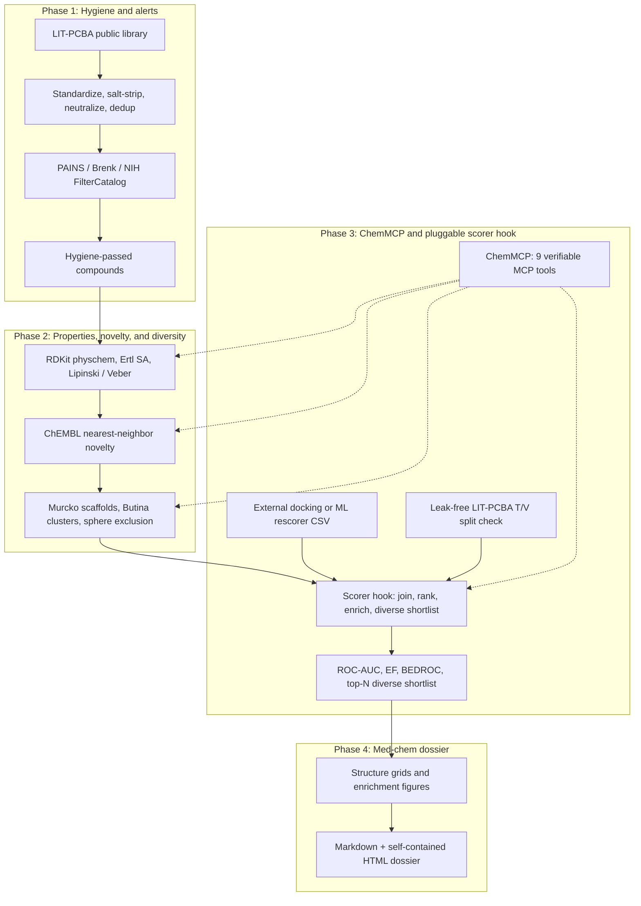
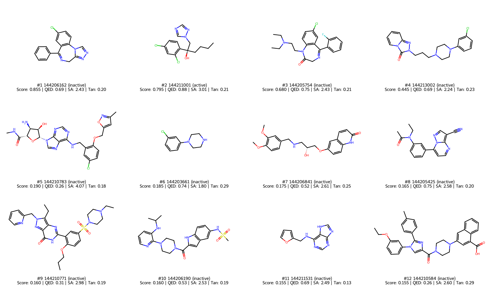
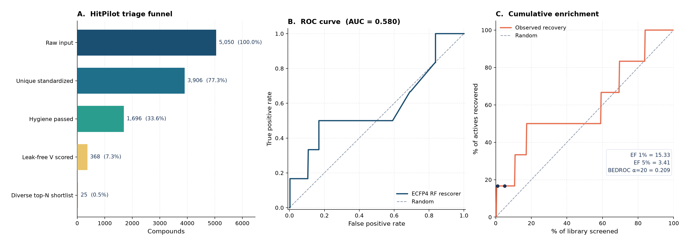
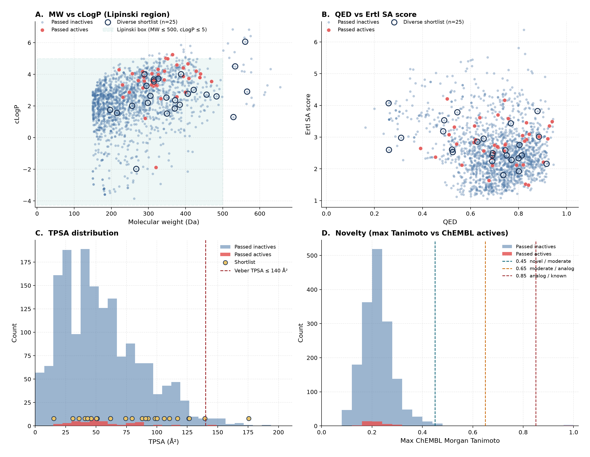

# HitPilot

**An auditable hit-triage and medicinal-chemistry copilot: take a public screening library to a leak-checked, diverse shortlist and a shareable med-chem dossier — without fabricating chemistry.**

[](https://github.com/hentablihamza/hitpilot/actions/workflows/ci.yml)
[](https://www.python.org/downloads/)
[](LICENSE)
[](https://www.rdkit.org/)
[](https://github.com/astral-sh/ruff)

HitPilot is open-source software by [Hentabli Hamza, Ph.D.](https://github.com/hentablihamza).
Version 0.1.0 runs end-to-end on public LIT-PCBA, ChEMBL, and PubChem data.

## What HitPilot does

Virtual screening rarely fails because a model cannot be trained. It fails
because the chemistry going into (and coming out of) a ranker is messy:
salts, duplicates, PAINS, structure leaks between train and test, and a
shortlist that is all one chemotype. HitPilot is a reproducible, inspectable
pipeline that tackles that work:

- Standardize SMILES with RDKit, strip salts, neutralize, and drop exact
  duplicate structures.
- Screen official PAINS, Brenk, and NIH FilterCatalog alerts, with
  drop-or-flag-only switches and a machine-readable audit log.
- Compute physicochemical properties (including the official Ertl SA score)
  and Lipinski / Veber flags.
- Score nearest-neighbor novelty against cached or live ChEMBL target
  actives, with optional PubChem PUG REST lookups.
- Map Bemis–Murcko scaffolds, cluster with Butina, and pick a diverse
  subset by sphere exclusion.
- Plug in *any* docking or ML rescorer as a CSV. HitPilot joins IDs (or
  SMILES), reports leak-checked ROC-AUC, enrichment factors, and BEDROC,
  and writes a score-ordered diverse shortlist.
- Produce a med-chem dossier — structure grids, enrichment plots, and a
  self-contained HTML report a chemist can review without rerunning code.

Nothing in the default path invents SMILES, scores, or metrics, and nothing
depends on unpublished models or private datasets.

## Architecture



The ChemMCP layer wraps the same verified functions the CLI uses, so an
MCP-compatible agent never gets a second, unchecked chemistry path. The
external CSV is the only plug-in point for a docking engine or ML model:
HitPilot does not retrain or rescore behind the scenes unless you ask it
to run the bundled leak-free ECFP4 baseline.

## Quickstart

Python 3.11+ is required. Install with [uv](https://docs.astral.sh/uv/) or pip:

```bash
git clone https://github.com/hentablihamza/hitpilot.git
cd hitpilot

# uv (recommended)
uv venv --python 3.12
uv pip install --python .venv/bin/python -e ".[dev]"

# or pip, in any virtualenv
pip install -e ".[dev]"
```

Then run the one-command public demo (LIT-PCBA `ESR1_ant` / ChEMBL `CHEMBL206`):

```bash
.venv/bin/hitpilot benchmark ESR1_ant
# equivalent: bash examples/run_demo.sh
```

The first run downloads public LIT-PCBA and ChEMBL files into `data/` and
writes Phase 1–4 outputs under `outputs/benchmark_ESR1_ant/` (both
directories are gitignored). Open
`outputs/benchmark_ESR1_ant/dossier/medchem_dossier.html` in a browser for
the self-contained report. To evaluate your own docking or ML table instead
of the bundled baseline:

```bash
.venv/bin/hitpilot benchmark ESR1_ant --scores-csv path/to/scores.csv
```

## Who this helps and how

**Computational chemists.** A reproducible, auditable triage path with zero
fabricated chemistry. Every drop reason, SHA-256 input hash, RDKit version,
and enrichment definition is written to disk. Official train/validation
structure leaks are detected and removed before any metric is reported.

**Medicinal chemists.** A ready-to-review dossier: structure grids for the
diverse shortlist, flagged liabilities, physicochemical distributions,
novelty versus a named ChEMBL target, and scaffold/cluster context. The
HTML report is self-contained — no kernel or notebook required.

**ML / AI drug discovery researchers.** Drop in any docking or ML rescorer
CSV (compound ID or SMILES, higher-is-better or docking energy) and get
leak-checked ROC-AUC, PR-AUC, EF at 1/5/10%, and official RDKit BEDROC,
plus a diverse top-N shortlist whose pairwise Morgan Tanimoto stays below
the cutoff. The bundled ECFP4 random forest is a transparent baseline, not
a claim of a state-of-the-art model.

**Ph.D. students.** A clean, tested, documented reference implementation of
standard hit-triage workflows: RDKit standardization, FilterCatalog alerts,
Lipinski/Veber, Murcko/Butina/sphere exclusion, and textbook VS enrichment,
all on public data you can re-download.

**Agent / LLM builders.** ChemMCP gives any MCP-compatible agent nine
verifiable chemistry tools over stdio — the same functions the CLI and the
tests use. Agents can standardize, look up ChEMBL/PubChem, evaluate a
rescorer CSV, and request a dossier without inventing structures.

## Example results

These figures and numbers come from the verified HitPilot 0.1.0 run of
`hitpilot benchmark ESR1_ant` on the public LIT-PCBA estrogen-receptor
alpha antagonist set (PubChem AID 743080; official set name `ESR_antago`)
against ChEMBL target CHEMBL206. A Markdown snapshot of the dossier is in
[`examples/example_dossier_ESR1_ant.md`](examples/example_dossier_ESR1_ant.md).



*Diverse top shortlist (sphere exclusion, pairwise Morgan Tanimoto &lt; 0.65).
Each panel is labeled with rank, PubChem SID, activity label, score, QED,
Ertl SA, and nearest-neighbor Tanimoto versus CHEMBL206 actives.*



*Left: triage funnel from 5,050 input SIDs to the 25-compound diverse shortlist.
Right: leak-free ROC and enrichment for the bundled ECFP4 random-forest
baseline on the hygiene-matched held-out set.*



*Physicochemical distributions for the 1,696 hygiene-passed compounds, with
Lipinski/Veber guides, actives highlighted, and the diverse shortlist ringed.*

### Leak-free baseline metrics (hygiene-matched held-out set)

The official LIT-PCBA `_T` / `_V` split is SID-level, so the same structure
can appear on both sides. HitPilot drops any standardized SMILES in `_V`
that also occurs in `_T` (**405** overlaps: 6 actives + 399 inactives)
before scoring. Metrics below are for the bundled ECFP4 random-forest
baseline (`random_state=42`), trained only on `_T` and evaluated on the
hygiene-passed, leak-free `_V` compounds (**N = 368**, 6 actives / 362
inactives). They demonstrate the hook; they are not a claim of a
state-of-the-art rescorer.

| Metric | Value |
| --- | ---: |
| Input compounds (SIDs) | 5,050 (102 active / 4,948 inactive) |
| Unique standardized SMILES | 3,906 |
| Hygiene-passed | 1,696 (40 active / 1,656 inactive) |
| ChEMBL CHEMBL206 reference actives | 1,101 unique (pChEMBL ≥ 6) |
| Unique Murcko scaffolds / Butina clusters | 822 / 1,275 |
| `_T`/`_V` structure leaks removed | 405 |
| Leak-free, hygiene-matched held-out set | 368 (6 active / 362 inactive) |
| ROC-AUC | 0.580 |
| PR-AUC | 0.108 |
| EF 1% (k = 4, 1 hit) | 15.33 |
| EF 5% (k = 18, 1 hit) | 3.407 |
| EF 10% (k = 37, 1 hit) | 1.658 |
| BEDROC (α = 20) | 0.209 |
| BEDROC (α = 80.5) | 0.216 |
| Hits in top 25 / 50 / 100 | 1 / 2 / 3 |
| Diverse shortlist | 25 compounds, 1 true active, 25 unique Murcko scaffolds |

Full counts, SHA-256 hashes, and per-compound tables are written by
`hitpilot benchmark` and summarized in the example dossier.

## Command reference

| Command | What it does |
| --- | --- |
| `hitpilot fetch-litpcba` | Download one public LIT-PCBA target and write a unified CSV. |
| `hitpilot hygiene` | Standardize compounds, apply PAINS/Brenk/NIH alerts, and write an audit log. |
| `hitpilot properties` | Compute RDKit descriptors, Ertl SA score, and Lipinski/Veber flags. |
| `hitpilot fetch-chembl` | Download unique ChEMBL actives for a target and cache them as CSV. |
| `hitpilot novelty` | Score Morgan (ECFP4-like) novelty against ChEMBL reference actives. |
| `hitpilot diversity` | Assign Bemis–Murcko scaffolds, Butina clusters, and a diverse subset. |
| `hitpilot phase2` | Run properties, novelty, and diversity and write a unified Phase 2 table. |
| `hitpilot baseline-score` | Train an ECFP4 random forest on LIT-PCBA `_T` and score leak-free `_V`. |
| `hitpilot score` | Join an external scorer CSV, report VS enrichment, and write a diverse shortlist. |
| `hitpilot dossier` | Write a publication-grade med-chem dossier from Phase 1–3 output directories. |
| `hitpilot benchmark` | Run the full Phase 1–4 public benchmark and write a med-chem dossier. |
| `hitpilot mcp` | Launch the ChemMCP server over stdio. |
| `hitpilot-mcp` | Console-script entry point for the same ChemMCP server. |

Every subcommand also accepts `--help` for flags and defaults.

## ChemMCP tools

ChemMCP exposes nine tools over stdio (`mcp` 2.x). They call the same
package functions as the CLI.

| Tool | Description |
| --- | --- |
| `standardize_and_screen_smiles` | Sanitize, strip salts, neutralize, canonicalize, deduplicate, and screen alerts. |
| `compute_physchem_properties` | Compute RDKit descriptors, Ertl SA score, and Lipinski/Veber flags. |
| `check_chembl_novelty` | Morgan ECFP4 nearest-neighbor novelty versus ChEMBL target actives. |
| `lookup_pubchem_compound` | Look up a PubChem CID and 2D similar CIDs via PUG REST. |
| `analyze_scaffolds_and_diversity` | Return Bemis–Murcko scaffolds, Butina clusters, and a diverse subset. |
| `evaluate_rescorer_csv` | Run the pluggable scorer hook and return enrichment plus a shortlist preview. |
| `run_hygiene_csv` | Run the Phase 1 hygiene batch pipeline on a CSV/TSV/SMI file. |
| `run_phase2_csv` | Run the Phase 2 properties, novelty, and diversity pipeline on a file. |
| `generate_medchem_dossier` | Write a publication-grade med-chem dossier from Phase 1–3 output directories. |

Copy-paste client config (Claude Desktop, Cursor, or any MCP host that
uses the `mcpServers` JSON shape):

```json
{
  "mcpServers": {
    "ChemMCP": {
      "command": "hitpilot-mcp"
    }
  }
}
```

If the console script is not on `PATH`, point `command` at your
virtualenv, or use the Typer entry point:

```json
{
  "mcpServers": {
    "ChemMCP": {
      "command": "/absolute/path/to/hitpilot/.venv/bin/hitpilot",
      "args": ["mcp"]
    }
  }
}
```

## Reproducibility and data provenance

- **Public sources only.** LIT-PCBA `ESR1_ant` (Valencia Labs mirror of
  PubChem AID 743080; official set name `ESR_antago`), ChEMBL target
  CHEMBL206 (human estrogen receptor, UniProt P03372), and optional
  PubChem PUG REST lookups. Unpublished research and private models are
  out of scope.
- **SHA-256 audit manifests.** Hygiene, Phase 2, scoring, dossier, and
  benchmark runs write JSON manifests with input hashes, tool versions,
  configuration, and exact counts.
- **Leak checking.** Official LIT-PCBA splits are SID-level. Before
  reporting enrichment, HitPilot removes every standardized SMILES in the
  validation fold that also appears in train.
- **Pinned deterministic seeds.** The bundled ECFP4 random-forest baseline
  uses `random_state=42`, `n_estimators=200`, `class_weight="balanced"`,
  and `n_jobs=1`. Cluster and fingerprint settings are recorded in the
  audit logs.
- **Standard metric definitions.** ROC-AUC and PR-AUC from
  `sklearn.metrics`; enrichment factor
  `(hits_in_top_k / k) / (n_actives / N)` with
  `k = max(1, int(round(frac * N)))`; BEDROC from
  `rdkit.ML.Scoring.Scoring.CalcBEDROC` (best-first, α = 20 and 80.5).

## Project layout

```text
hitpilot/
  src/hitpilot/          # Package: hygiene, properties, novelty, diversity,
                         # scoring hook, ChemMCP server, dossier, benchmark CLI
  tests/                 # Offline unit and CLI tests (HTTP is mocked)
  examples/              # Demo script and committed ESR1_ant dossier snapshot
  docs/images/           # Committed example figures for the README
  docs/CV_BULLETS.md     # Recruiter-facing bullets from verified numbers
  .github/workflows/     # CI: Ruff + pytest on Python 3.11 and 3.12
```

`data/litpcba/`, `data/chembl/`, and `outputs/` are gitignored. Re-run
`hitpilot benchmark` to regenerate them; cached public downloads are reused
when present.

## Testing

```bash
.venv/bin/pytest -v
.venv/bin/ruff check src tests
```

All default tests are offline (PubChem and ChEMBL HTTP is mocked). Live
network checks, if added later, must be marked `@pytest.mark.network` so
GitHub Actions can skip them with `pytest -v -m "not network"`. See
[CONTRIBUTING.md](CONTRIBUTING.md) for how to extend alert catalogs, the
scorer hook, or ChemMCP.

## Roadmap

The original five-phase map is complete in 0.1.0:

- [x] **Phase 1 — Hygiene and alerts.** RDKit standardization, salt stripping,
      exact dedup, PAINS/Brenk/NIH FilterCatalog, auditable logs, CLI, tests.
- [x] **Phase 2 — Properties, novelty, and diversity.** Physchem filters,
      ChEMBL novelty, Murcko scaffolds, Butina clustering, sphere exclusion.
- [x] **Phase 3 — ChemMCP, CLI, and a pluggable scorer hook.** Nine MCP tools,
      docking/ML CSV join, leak-free VS enrichment, diverse shortlist.
- [x] **Phase 4 — Med-chem dossier on the public benchmark.** Figures,
      Markdown + self-contained HTML, `hitpilot benchmark ESR1_ant`.
- [x] **Phase 5 — GitHub release and CV packaging.** License, citation,
      contributing guide, CI, example assets, and this README.

## License

MIT. See [LICENSE](LICENSE). Copyright (c) 2026 Hentabli Hamza.

## Citation

If you use HitPilot, please cite the software (also recorded in
[CITATION.cff](CITATION.cff)):

```text
Hentabli, H. (2026). HitPilot (Version 0.1.0) [Computer software].
https://github.com/hentablihamza/hitpilot
```
