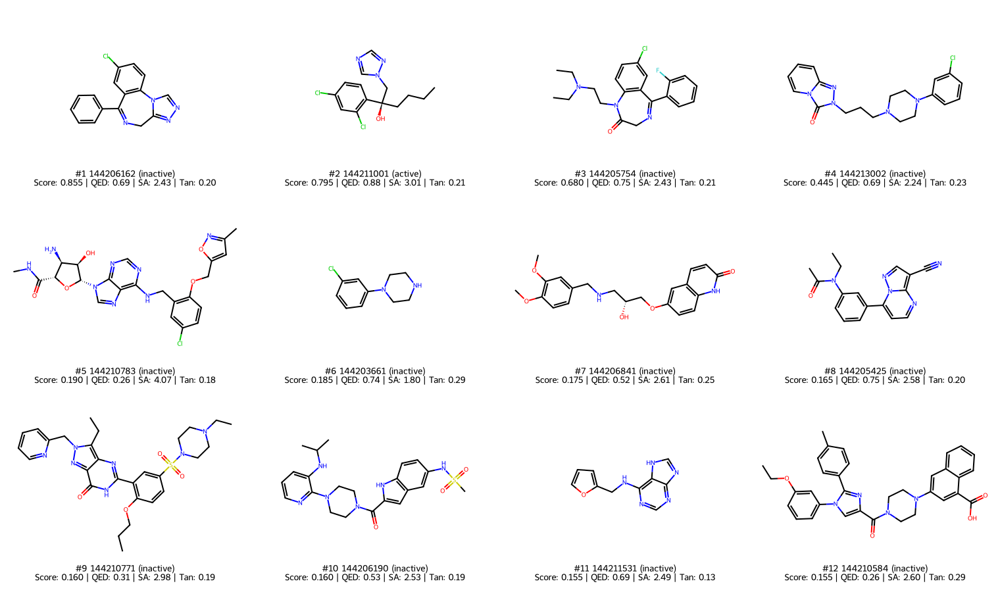
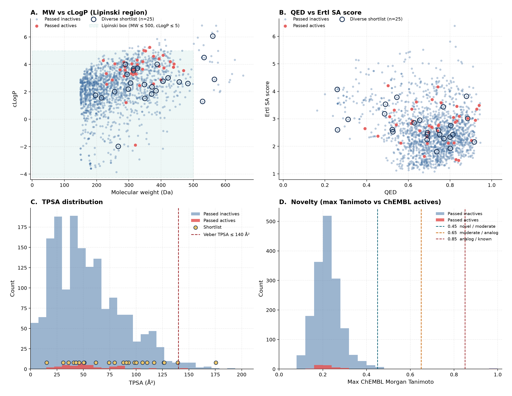
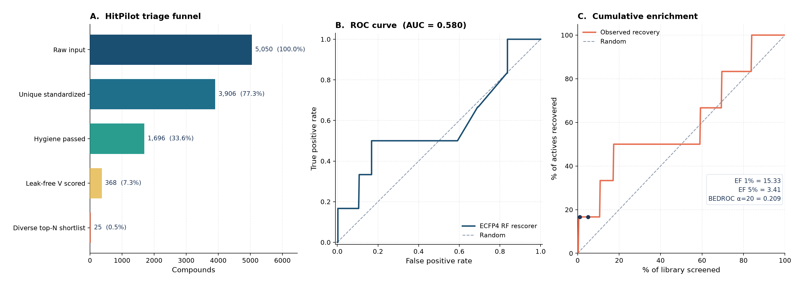

> Snapshot of the HitPilot 0.1.0 med-chem dossier for the public LIT-PCBA `ESR1_ant` benchmark (CHEMBL206). Three figures are committed under `docs/images/`; SHA-256 paths below refer to files written by a local `hitpilot benchmark` run (`outputs/` is gitignored).

# HitPilot Med-Chem Dossier: ESR1_ant — Estrogen receptor alpha (antagonist)

**Target:** `ESR1_ant` (LIT-PCBA)  ·  **ChEMBL reference:** `CHEMBL206`  
**Generated:** 2026-11-24T07:31:10Z (UTC)  ·  **HitPilot** 0.1.0  ·  **RDKit** 2026.09.2

All chemistry and metrics in this dossier are computed from public LIT-PCBA and ChEMBL
data with verified RDKit / scikit-learn code. Scores, SMILES, and enrichment values are
never invented.

## Input audit (SHA-256)

| Input | SHA-256 | Path |
| --- | --- | --- |
| `all_compounds` | `3b5aaacb2aee5038d72b6253f59d21e75c22ab5b88d01ba0749cd424dc001789` | `outputs/benchmark_ESR1_ant/phase1/all_compounds.csv` |
| `phase2_enriched` | `5c8592ccd26c592568ed349b855e586517aa9c26263b881410411821e1cc5305` | `outputs/benchmark_ESR1_ant/phase2/phase2_enriched.csv` |
| `ranked_compounds` | `9196f702b2fd43a002e7fd3de2f2626c710b89a061284fbb9adaa7614888ab0f` | `outputs/benchmark_ESR1_ant/phase3/ranked_compounds.csv` |
| `shortlist` | `5be25cd1c9749575d464281d41200271ebb2d8a33fe11dccecc4d000d82a6187` | `outputs/benchmark_ESR1_ant/phase3/shortlist_topN_diverse.csv` |
| `hygiene_audit` | `1b4a1d9e1acafdce94e1615bd35c424b92e0c5794049600f3800508fddcf78fc` | `outputs/benchmark_ESR1_ant/phase1/audit_log.json` |
| `phase2_audit` | `d17e4e49fa050dba2b4f0c3d87b26fe1a78836835d28629880492a10e274ccc6` | `outputs/benchmark_ESR1_ant/phase2/audit_log.json` |
| `scoring_audit` | `0fcee9cdb18cd7ccc6c3b0c8b40f5591ebd569210c60021692dfe1e50aacca21` | `outputs/benchmark_ESR1_ant/phase3/audit_log.json` |
| `baseline_stats` | `eef56b0276291f3a8379c63bf1e1e13910c5882509b51ee62c4159856476fd1c` | `outputs/benchmark_ESR1_ant/phase3/baseline_stats.json` |
| `scaffold_summary` | `63f65a92a95eee55e6a1450e78dcd9edf23699a0851391c7d823027f1bee8cb5` | `outputs/benchmark_ESR1_ant/phase2/scaffold_summary.csv` |

## Executive summary and triage funnel

HitPilot applies a strict, auditable funnel: standardize and deduplicate the public
LIT-PCBA library, drop PAINS / Brenk / NIH liabilities, attach physicochemical
descriptors and ChEMBL nearest-neighbor novelty, then rescore only the leak-free
held-out `_V` split (training is confined to `_T`) and pick a score-ordered diverse
shortlist by Morgan sphere exclusion.

| Stage | Count | % of raw input |
| --- | ---: | ---: |
| Raw input | 5,050 | 100.00% |
| Unique standardized | 3,906 | 77.35% |
| Hygiene passed | 1,696 | 33.58% |
| Leak-free V scored | 368 | 7.29% |
| Diverse top-N shortlist | 25 | 0.50% |

### Leak-free `_T` -> `_V` audit

The official LIT-PCBA train/validation files are SID-level, so the same standardized
structure can appear in both `_T` and `_V`. Before the baseline scorer is trained,
every `_V` structure whose canonical SMILES is present in `_T` is removed.

| Split | Standardized | Actives | Inactives |
| --- | ---: | ---: | ---: |
| Train `_T` | 3,788 | 77 | 3,711 |
| Valid `_V` (before leak removal) | 1,262 | 25 | 1,237 |
| Held-out `_V` scored (leak-free) | 857 | 19 | 838 |

**Standardized SMILES overlap removed from `_V`:** 405 (structures shared with `_T`; evaluation is leak-free).

Hygiene pass rates by label:

| Label | Input | Passed | Dropped | Pass rate |
| --- | ---: | ---: | ---: | ---: |
| active | 102 | 40 | 62 | 39.22% |
| inactive | 4,948 | 1,656 | 3,292 | 33.47% |

Phase 2 context (hygiene-passed compounds):

- Median MW 249.2, cLogP 2.55, TPSA 47.6, QED 0.725, SA 2.433; Lipinski pass 1,681 (99.12%), Veber pass 1,658 (97.76%).
- Novelty vs `CHEMBL206` (1,101 unique actives): known or close match 4, close analog 1, moderate novelty 8, novel chemotype 1683; median max Tanimoto 0.215.
- 822 unique Murcko scaffolds, 1,275 Butina clusters, 1,448 sphere-exclusion representatives (38/40 actives captured).

## Figures

### Top diverse shortlist

### Phase 1 structural-alert examples

_This snapshot commits three of the five dossier figures under `docs/images/`. Regenerate the PAINS/Brenk/NIH alert grid with `hitpilot benchmark ESR1_ant`._

### Physicochemical and novelty distributions

### Enrichment and triage funnel

### Scaffolds and clusters

_The Butina / Murcko figure is produced by `hitpilot benchmark ESR1_ant` (see `outputs/benchmark_ESR1_ant/dossier/figures/scaffold_and_clusters.png`)._

## Virtual-screening enrichment metrics

Metrics are computed only on hygiene-passed compounds that also belong to the leak-free
held-out `_V` set (matched to baseline or user-supplied scores). Ranking respects
`higher_is_better`. ROC-AUC and PR-AUC use scikit-learn; EF uses the standard VS
definition with k = max(1, round(fN)); BEDROC uses RDKit CalcBEDROC at alpha = 20
and alpha = 80.5.

| Metric | Value |
| --- | --- |
| Scored compounds (N) | 368 |
| Actives / inactives | 6 / 362 |
| ROC-AUC | 0.5801 |
| PR-AUC | 0.1079 |
| EF 1% | 15.333 (k=4, hits=1) |
| EF 5% | 3.407 (k=18, hits=1) |
| EF 10% | 1.658 (k=37, hits=1) |
| BEDROC alpha=20 | 0.2091 |
| BEDROC alpha=80.5 | 0.2161 |
| Hits in top 25 / 50 / 100 | 1 / 2 / 3 |
| Diverse shortlist hits / unique Murcko scaffolds | 1 / 25 |

## Top-25 diverse hit shortlist

Score-ordered Morgan sphere exclusion (pairwise Tanimoto < 0.65 by default) so the
best-scoring hits seed diverse spheres first.

| Rank | ID | Label | Score | MW | cLogP | TPSA | QED | SA | Lipinski | Veber | Cluster | Max Tan | Nearest ChEMBL (pChEMBL) | Novelty | Canonical SMILES |
| ---: | --- | --- | ---: | ---: | ---: | ---: | ---: | ---: | --- | --- | --- | ---: | --- | --- | --- |
| 1 | 144206162 | inactive | 0.855 | 294.7 | 3.27 | 43.1 | 0.691 | 2.429 | True | True | 229 (n=2) | 0.200 | CHEMBL335465 (9.82) | novel_chemotype | `Clc1ccc2c(c1)C(c1ccccc1)=NCc1nncn1-2` |
| 2 | 144211001 | active | 0.795 | 314.2 | 3.66 | 50.9 | 0.885 | 3.013 | True | True | 1247 (n=1) | 0.209 | CHEMBL2179253 (9.51) | novel_chemotype | `CCCC[C@@](O)(Cn1cncn1)c1ccc(Cl)cc1Cl` |
| 3 | 144205754 | inactive | 0.680 | 387.9 | 4.00 | 35.9 | 0.751 | 2.426 | True | True | 1018 (n=1) | 0.211 | CHEMBL954 (8.88) | novel_chemotype | `CCN(CC)CCN1C(=O)CN=C(c2ccccc2F)c2cc(Cl)ccc21` |
| 4 | 144213002 | inactive | 0.445 | 371.9 | 2.36 | 45.8 | 0.690 | 2.242 | True | True | 1222 (n=1) | 0.229 | CHEMBL178665 (9.34) | novel_chemotype | `O=c1n(CCCN2CCN(c3cccc(Cl)c3)CC2)nc2ccccn12` |
| 5 | 144210783 | inactive | 0.190 | 529.0 | 1.30 | 175.5 | 0.259 | 4.069 | False | False | 1151 (n=1) | 0.181 | CHEMBL5199803 (9.72) | novel_chemotype | `CNC(=O)[C@H]1O[C@@H](n2cnc3c(NCc4cc(Cl)ccc4OCc4cc(C)no4)ncnc32)[C@H](O)[C@@H]1N` |
| 6 | 144203661 | inactive | 0.185 | 196.7 | 1.75 | 15.3 | 0.737 | 1.804 | True | True | 937 (n=1) | 0.286 | CHEMBL178665 (9.34) | novel_chemotype | `Clc1cccc(N2CCNCC2)c1` |
| 7 | 144206841 | inactive | 0.175 | 384.4 | 2.07 | 92.8 | 0.523 | 2.608 | True | True | 1065 (n=1) | 0.245 | CHEMBL5821554 (9.82) | novel_chemotype | `COc1ccc(CNC[C@@H](O)COc2ccc3[nH]c(=O)ccc3c2)cc1OC` |
| 8 | 144205425 | inactive | 0.165 | 305.3 | 2.64 | 74.3 | 0.745 | 2.583 | True | True | 1006 (n=1) | 0.205 | CHEMBL4745817 (9.62) | novel_chemotype | `CCN(C(C)=O)c1cccc(-c2ccnc3c(C#N)cnn23)c1` |
| 9 | 144210771 | inactive | 0.160 | 565.7 | 2.91 | 126.3 | 0.311 | 2.980 | False | True | 1150 (n=1) | 0.193 | CHEMBL243790 (8.91) | novel_chemotype | `CCCOc1ccc(S(=O)(=O)N2CCN(CC)CC2)cc1-c1nc2c(CC)n(Cc3ccccn3)nc2c(=O)[nH]1` |
| 10 | 144206190 | inactive | 0.160 | 456.6 | 2.72 | 110.4 | 0.526 | 2.528 | True | True | 1031 (n=1) | 0.191 | CHEMBL4791503 (9.55) | novel_chemotype | `CC(C)Nc1cccnc1N1CCN(C(=O)c2cc3cc(NS(C)(=O)=O)ccc3[nH]2)CC1` |
| 11 | 144211531 | inactive | 0.155 | 215.2 | 1.56 | 79.6 | 0.693 | 2.491 | True | True | 1177 (n=1) | 0.129 | CHEMBL5787351 (9.41) | novel_chemotype | `c1coc(CNc2ncnc3nc[nH]c23)c1` |
| 12 | 144210584 | inactive | 0.155 | 560.7 | 6.06 | 87.9 | 0.260 | 2.599 | False | True | 1146 (n=1) | 0.290 | CHEMBL180873 (9.57) | novel_chemotype | `CCOc1cccc(-n2cc(C(=O)N3CCN(c4cc(C(=O)O)c5ccccc5c4)CC3)nc2-c2ccc(C)cc2)c1` |
| 13 | 144204908 | inactive | 0.145 | 298.4 | 2.20 | 50.3 | 0.917 | 2.159 | True | True | 986 (n=1) | 0.222 | CHEMBL5858899 (9.11) | novel_chemotype | `Cc1cc(-c2ccccc2)nnc1NCCN1CCOCC1` |
| 14 | 144213898 | inactive | 0.135 | 421.9 | 3.02 | 106.1 | 0.768 | 3.435 | True | True | 218 (n=2) | 0.188 | CHEMBL5972367 (9.64) | novel_chemotype | `CS(=O)(=O)c1ccc([C@@H](C[C@H]2CCC(=O)C2)C(=O)Nc2cnccn2)cc1Cl` |
| 15 | 144211568 | inactive | 0.130 | 314.7 | 3.55 | 46.0 | 0.804 | 2.755 | True | True | 180 (n=2) | 0.200 | CHEMBL3234617 (9.00) | novel_chemotype | `O[C@@](c1ccc(F)cc1)(c1cncnc1)c1ccccc1Cl` |
| 16 | 144206563 | inactive | 0.130 | 533.6 | 4.50 | 61.8 | 0.545 | 3.784 | True | True | 1053 (n=1) | 0.194 | CHEMBL3774737 (8.92) | novel_chemotype | `COC[C@H](c1ccc(C(F)(F)F)cc1)N1CCN(C2(C)CCN(C(=O)c3c(C)ncnc3C)CC2)C[C@H]1C` |
| 17 | 144203730 | inactive | 0.130 | 256.1 | 2.01 | 90.7 | 0.814 | 2.424 | True | True | 946 (n=1) | 0.170 | CHEMBL3234617 (9.00) | novel_chemotype | `Nc1nnc(-c2cccc(Cl)c2Cl)c(N)n1` |
| 18 | 144203664 | inactive | 0.130 | 326.8 | 3.72 | 30.9 | 0.800 | 2.334 | True | True | 938 (n=1) | 0.211 | CHEMBL121978 (9.00) | novel_chemotype | `CN1CCN(C2=Nc3cc(Cl)ccc3Nc3ccccc32)CC1` |
| 19 | 144211327 | inactive | 0.125 | 483.4 | 2.61 | 116.9 | 0.486 | 3.183 | True | True | 1169 (n=1) | 0.228 | CHEMBL5961628 (8.81) | novel_chemotype | `COc1cnc(OC)n2nc(NS(=O)(=O)c3c(OCC(F)F)cccc3C(F)(F)F)nc12` |
| 20 | 144206352 | inactive | 0.125 | 370.8 | 1.84 | 126.7 | 0.629 | 2.855 | True | True | 1040 (n=1) | 0.154 | CHEMBL3581682 (9.15) | novel_chemotype | `NS(=O)(=O)c1cc(-c2nnn[nH]2)c(NCc2cccs2)cc1Cl` |
| 21 | 144204442 | inactive | 0.125 | 267.2 | -1.98 | 139.5 | 0.491 | 3.531 | True | True | 82 (n=3) | 0.132 | CHEMBL4588281 (9.52) | novel_chemotype | `Nc1ncnc2c1ncn2[C@@H]1O[C@H](CO)[C@@H](O)[C@H]1O` |
| 22 | 144211539 | inactive | 0.115 | 289.3 | 4.00 | 40.9 | 0.801 | 1.923 | True | True | 1179 (n=1) | 0.345 | CHEMBL4590512 (8.75) | novel_chemotype | `N#Cc1ccc(CC(=O)c2cccc(C(F)(F)F)c2)cc1` |
| 23 | 144204457 | inactive | 0.115 | 349.8 | 1.52 | 61.9 | 0.879 | 3.820 | True | True | 973 (n=1) | 0.173 | CHEMBL5203282 (8.98) | novel_chemotype | `CN1C(=O)COc2c(C(=O)N[C@@H]3CN4CCC3CC4)cc(Cl)cc21` |
| 24 | 144211082 | inactive | 0.105 | 406.2 | 2.77 | 98.5 | 0.655 | 2.953 | True | True | 1155 (n=1) | 0.228 | CHEMBL5780644 (9.47) | novel_chemotype | `CCOc1nc(F)cc2nc(S(=O)(=O)Nc3c(Cl)cccc3Cl)nn12` |
| 25 | 144204213 | inactive | 0.105 | 348.4 | 2.53 | 100.2 | 0.771 | 2.281 | True | True | 967 (n=1) | 0.217 | CHEMBL5870216 (9.80) | novel_chemotype | `Cc1cccc(Nc2ccncc2S(=O)(=O)NC(=O)NC(C)C)c1` |

## Top Butina clusters and Bemis-Murcko scaffolds

| Rank | Murcko scaffold | Generic framework | Acyclic | Count | Actives | Inactives | Examples |
| ---: | --- | --- | --- | ---: | ---: | ---: | --- |
| 1 | `c1ccccc1` | `C1CCCCC1` | False | 374 | 1 | 373 | 144208291, 144213763, 144213746, 144213693, 144213692 |
| 2 | `(acyclic)` | `—` | True | 73 | 0 | 73 | 144213778, 144213475, 144212354, 144212089, 144212046 |
| 3 | `c1ccc(Cc2ccccc2)cc1` | `C1CCC(CC2CCCCC2)CC1` | False | 27 | 0 | 27 | 144214049, 144213904, 144213394, 144213310, 144212231 |
| 4 | `C1CCCCC1` | `C1CCCCC1` | False | 24 | 0 | 24 | 144213836, 144213698, 144213610, 144213439, 144212653 |
| 5 | `c1ccc2ccccc2c1` | `C1CCC2CCCCC2C1` | False | 19 | 0 | 19 | 144213968, 144213222, 144212460, 144208179, 144207930 |
| 6 | `c1ccc2[nH]ccc2c1` | `C1CCC2CCCC2C1` | False | 17 | 0 | 17 | 144213048, 144207132, 144206171, 144213243, 144211617 |
| 7 | `c1ncncn1` | `C1CCCCC1` | False | 17 | 0 | 17 | 144211736, 144211210, 144211124, 144211070, 144209647 |
| 8 | `c1ccncc1` | `C1CCCCC1` | False | 14 | 0 | 14 | 144211446, 144212793, 144212368, 144211046, 144210999 |
| 9 | `c1ccc(Nc2ccccc2)cc1` | `C1CCC(CC2CCCCC2)CC1` | False | 13 | 0 | 13 | 144211932, 144209038, 144204321, 144204121, 144203895 |
| 10 | `O=C(c1ccccc1)c1ccccc1` | `CC(C1CCCCC1)C1CCCCC1` | False | 12 | 0 | 12 | 144208191, 144207014, 144213944, 144213797, 144213750 |
| 11 | `c1ccc(-c2ccccc2)cc1` | `C1CCC(C2CCCCC2)CC1` | False | 12 | 0 | 12 | 144209442, 144205912, 144214000, 144212670, 144211795 |
| 12 | `O=c1[nH]c(=O)c2[nH]cnc2[nH]1` | `CC1CC(C)C2CCCC2C1` | False | 10 | 0 | 10 | 144210348, 144206112, 144204417, 144204022, 144210336 |
| 13 | `C1CCOCC1` | `C1CCCCC1` | False | 9 | 0 | 9 | 144206924, 144205869, 144212372, 144212319, 144207628 |
| 14 | `O=C1C=C2CC[C@H]3[C@@H]4CCCC4CC[C@@H]3C2CC1` | `CC1CCC2C(CCC3C4CCCC4CCC23)C1` | False | 9 | 0 | 9 | 144213947, 144203907, 144212587, 144207887, 144206713 |
| 15 | `c1ccc(Oc2ccccc2)cc1` | `C1CCC(CC2CCCCC2)CC1` | False | 9 | 0 | 9 | 144211096, 144210927, 144210830, 144209231, 144208156 |

## Phase 1 structural-alert breakdown

Drop-reason counts are not mutually exclusive: a compound may match more than one
catalog or also be marked as a duplicate.

| Drop reason or catalog | Compounds |
| --- | ---: |
| `brenk_alert` | 2,751 |
| `duplicate_structure` | 1,144 |
| `nih_alert` | 1,011 |
| `pains_alert` | 220 |
| | |
| Catalog `BRENK` | 2,751 |
| Catalog `NIH` | 1,011 |
| Catalog `PAINS_A` | 98 |
| Catalog `PAINS_B` | 99 |
| Catalog `PAINS_C` | 40 |

### Example flagged liabilities

Examples below are selected to cover PAINS, Brenk, and NIH (actives first when available).
The corresponding structure grid is generated by `hitpilot benchmark ESR1_ant` as
`outputs/benchmark_ESR1_ant/dossier/figures/flagged_alerts_grid.png` (not committed here).

| ID | Label | Catalog + rule | Canonical SMILES |
| --- | --- | --- | --- |
| 144212468 | active | PAINS_A: anil_di_alk_B(251); BRENK: imine_1; BRENK: quaternary_nitrogen_1; BRENK: Sulfonic_acid_2; NIH: gte_2_sulfonic_acid; NIH: quinone_methide | `CCN(CC)c1ccc(C(=C2C=CC(=[N+](CC)CC)C=C2)c2ccc(S(=O)(=O)O)cc2S(=O)(=O)O)cc1` |
| 144203670 | active | BRENK: Aliphatic_long_chain | `CN(C(=O)CCCOc1ccc2[nH]c(=O)ccc2c1)C1CCCCC1` |
| 144212747 | inactive | NIH: activated_vinyl_ester | `CCOC(=O)OC1=C(c2cc(C)ccc2C)C(=O)NC12CCC(OC)CC2` |
| 144204227 | active | PAINS_A: anil_di_alk_C(246) | `CC(=O)N1CCN(c2ccc(OC[C@H]3CO[C@](Cn4ccnc4)(c4ccc(Cl)cc4Cl)O3)cc2)CC1` |
| 144205717 | active | BRENK: Aliphatic_long_chain; BRENK: imine_1; BRENK: imine_2 | `CCCCNC(=N)NC(=N)N` |
| 144204552 | inactive | NIH: activated_vinyl_sulfonate | `CC1=CC(=O)NS(=O)(=O)O1` |
| 144209720 | active | PAINS_A: anil_di_alk_E(186); BRENK: alkyl_halide; NIH: primary_halide_sulfate | `N[C@@H](Cc1ccc(N(CCCl)CCCl)cc1)C(=O)O` |
| 144206201 | active | BRENK: Aliphatic_long_chain; BRENK: isolated_alkene | `CCCCCC[C@@H](O)C/C=C\CCCCCCCC(=O)O` |
